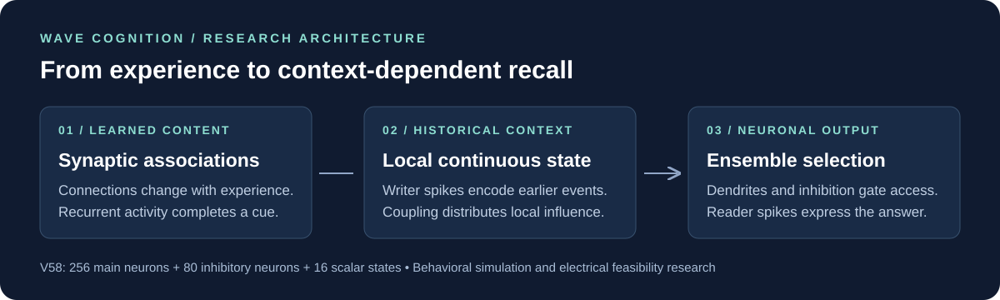

# Wave Cognition

### Neuronal memory, context-dependent computation, and physical circuit models

**Can learned neural connections store content while local continuous dynamics control which neuronal ensemble recalls it?** Wave Cognition investigates this question through spiking-neuron simulations, paired causal interventions, and behavioral electrical models.

This repository documents the path from the original **recurrent memristive simulation** to the newer **neuron–shared-state research architecture**. It presents the mechanisms explored, the experiments that failed, the controls that succeeded, and the hardware questions that remain.

**Current research snapshot: V58 · Documentation updated October 17, 2026**

[Research journey](docs/research-history.md) · [Architecture](docs/architecture.md) · [Latest evidence](docs/results-v58.md) · [Next experiments](docs/roadmap.md) · [Publication scope](docs/publication-scope.md)

## Latest findings

V58 tests **256 main neurons, 80 inhibitory neurons, and 16 shared scalar states**. The network learns associations, receives different earlier histories, and then faces identical present inputs. Its answer comes from downstream neuronal spikes; an external evaluator scores those spikes without decoding the internal shared state.

| V58 observation | Result | Interpretation |
|---|---:|---|
| Nominal partial-cue recall | **0.943 mean F1** | Six independently acquired memory sets; 48 episodes per condition |
| Equally calibrated spike-broadcast control | **0.943 mean F1** | The control ties nominal recall |
| Shared-state erase / feedback disabled | **0.000 mean F1** | These interventions disrupt recall in the tested spatial circuit |
| Combined modeled stress | **0.623 vs. 0.494 F1** | Spatial coupling performs better than broadcast under this specified stress model |
| Nominal emitted-spike count | **25.8% fewer** | Fewer simulated spikes at equal observed recall; not a power measurement |

The study contains **384 nominal/intervention episodes**, **1,584 stress episodes**, and **14 small-loop ngspice transients**. Confidence intervals resample the six independent memory sets. Read the [evidence and uncertainty](docs/results-v58.md) or inspect the [public aggregate statistics](docs/evidence/v58-summary.json).

## How it works

| Mechanism | Role in the current memory experiment |
|---|---|
| Learned recurrent connections | Store associations acquired from experience |
| Writer-neuron activity | Drives local continuous states that retain earlier history |
| Neighbor coupling | Distributes the influence of local state |
| Dendritic and inhibitory interactions | Regulate which reader ensemble can express an association |
| Reader-neuron spikes | Complete the partially cued pattern and provide the observable output |

The selected V58 configuration uses **nonoscillatory scalar dynamics**. “Wave Cognition” is the project name and includes earlier oscillatory studies; the current results do not establish that oscillations are necessary. The physical proposal uses circuit state and conductances, while the simulator integrates these dynamics on a conventional computer.

## The research journey

| Stage | Main question |
|---|---|
| Original memristive work | How can retention, recurrence, and gating support temporal tasks? |
| V1–V21 | How should neuronal and continuous-state mechanisms interact, and how should they be compared fairly? |
| V22–V30 | Can actual neuronal ensembles produce the answer, and where does learning or selection fail? |
| Recovered V32–V40 lineage | How can learned neuronal content interact with history-dependent access? |
| V42–V49 application branches | What changes when anatomical connectivity and navigation workloads are introduced? |
| V50–V58 | Which memory mechanisms survive causal controls, and what circuit constraints limit implementation? |

The [revision-by-revision history](docs/research-history.md) explains the branches and gaps. It includes negative results, such as V28's unsuccessful reversal and controls that match the current model. Forty-seven [historical reading notes](docs/history/INDEX.json) preserve the documented path.

## Repository guide

| Location | Contents |
|---|---|
| [`docs/research-history.md`](docs/research-history.md) | Research progression, branches, audits, and failed experiments |
| [`docs/architecture.md`](docs/architecture.md) | Neurons, learning, local state, and circuit interpretation |
| [`docs/results-v58.md`](docs/results-v58.md) | Latest findings, confidence intervals, and evidence limits |
| [`docs/roadmap.md`](docs/roadmap.md) | Concrete next experiments and required measurements |
| [`docs/history/`](docs/history/) | Historical notes, provenance index, and original introduction |
| [`main.py`](main.py), [`modules/`](modules/), [`devices/`](devices/) | Original memristive implementation, retained in place |

The original implementation and its [historical README](docs/history/original-memristive-readme.md) remain available. It is a distinct code lineage: its task scores and the newer V58 results must not be combined into a single system claim.

## Research status and publication scope

The current evidence is **computational and behavioral electrical simulation**. It supports specific mechanisms within the tested models. It does not demonstrate fabricated silicon, measured supply-energy savings, a biologically validated brain reconstruction, or treatment of memory loss.

This update publishes the English research narrative, historical notes, and aggregate results. **The newer model source, trained weights, saved neural traces, and detailed trial data remain in the local research archive for this documentation release.** The original root-level code is public. See [publication scope and verification](docs/publication-scope.md) for exactly what is included.
