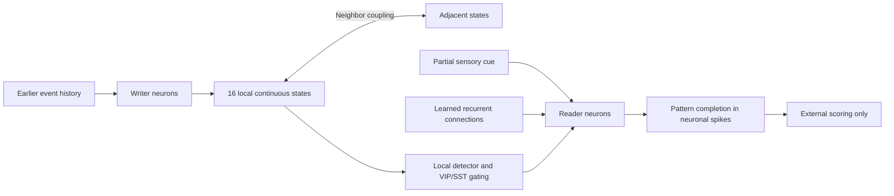

# Architecture and research question

[Back to the project](../README.md) · [V58 evidence](results-v58.md)

## Content, access, and output

The current memory experiment separates learned association content from history-dependent access. Synaptic weights encode associations acquired during exposure. A local continuous state carries information about earlier events. Dendritic and inhibitory interactions determine which neuronal ensemble expresses the stored association when a partial cue arrives.

## Neuron and circuit components

| Component | Implemented research abstraction | Proposed physical interpretation |
|---|---|---|
| Main neurons | 256 cells with 12 reduced dendritic compartments: 8 basal, 3 apical, 1 trunk; synaptic filtering, nonlinear dendritic integration, threshold/reset soma, optional adaptation | Local capacitive state, conductance/current paths, comparators and reset circuitry |
| Inhibitory cells | 80 cells, organized as PV and paired SST/VIP motifs over 16 tiles | Local inhibitory and disinhibitory circuits |
| Association storage | Bounded recurrent weights changed by local pre/post activity during acquisition | Programmable synaptic conductances; a characterized programming circuit is still required |
| Shared state | 16 nonrotating scalar states in the selected V58 configuration | Leaky local gm-C states with neighboring couplers |
| Behavioral output | Reader-neuron spikes after an identical partial cue | Observable event activity, rather than a direct state-vector decoder |

These are reduced engineering neurons. The AMPA/NMDA-like filters, compartments, and inhibitory labels do not establish biophysical fidelity to a specific recorded cell or circuit.

The compact solver groups equivalent basal branches while retaining the full model's conditions for equivalence. It is a numerical optimization, not a claim that every possible 12-compartment circuit can always be reduced this way.

## What is the algorithm?

The inference algorithm is the coupled evolution of neuronal, synaptic, and local continuous states. It combines event-driven synaptic input, dendritic integration, spiking inhibition, recurrent pattern completion, and history-dependent modulation. There is no fitted classifier on the shared-state coordinates in the current behavioral path.

V58 acquisition uses bounded local pre/post potentiation. Learned recurrent feedback is disabled during acquisition and enabled during recall. Candidate operating points are calibrated on training histories and selected on validation histories. The six final memory sets are acquired and their weights frozen before new test histories are generated. This is **acquisition followed by frozen recall**, not a demonstration of continual online adaptation. Earlier online-adaptation experiments are tracked separately in the [history](research-history.md).

The selected V58 setting has reader emission disabled. The demonstrated path is writer → shared state → reader; beneficial reciprocal reader emission remains unestablished.

## Does a neuron have an ALU or memory?

A neuron in the proposed physical circuit is a dynamical circuit element, rather than an instruction-executing ALU. Nevertheless, its voltages, filter states, adaptation state, and synaptic conductances retain information. The accurate distinction is **physical local state and synaptic storage**, not “no memory.” The Python simulator still uses ordinary CPU arithmetic and memory to solve the equations.

Physical implementation also requires configuration, routing, calibration, and input/output circuitry. A complete architecture comparison must count these costs, rather than comparing only a capacitor with a full digital system.

## Relation to the original repository

The original root-level model explores memristive retention, recurrent modules, population coding, gating, and externally decoded tasks. The current Wave Cognition model is a distinct code lineage with a different neural output interface and experimental protocol. Results from those tracks must not be combined into a single claimed system score. The original code remains in place; its [historical README](history/original-memristive-readme.md) is preserved as a dated artifact that can contain superseded wording.

## Hardware scope

V54 maps a particular V52 workload to behavioral electrical blocks; V55–V57 analyze costs and audit those traces. V58 returns to the learned-memory configuration and adds small-loop electrical stress experiments. These are separate configurations of a related research architecture. Their successes do not constitute a single validated chip that simultaneously learns, reproduces a fly circuit, decodes human brain recordings, and saves measured power.

No foundry PDK, transistor-layout verification, fabricated chip, tissue recording, or clinical experiment has been demonstrated by the evidence described here. This documentation release does not upload the current model source, trained weights, or detailed data.
