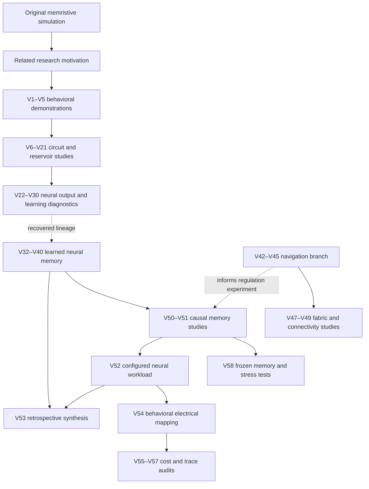

# Research journey

[Back to the project](../README.md) · [Historical source index](history/INDEX.json)

This is a revision history, not a claim that 58 complete releases form one linear model. Some revisions are audits or cost studies; several branches use different tasks, training methods, or neural abstractions. The current research review centers on V58, while 47 public historical notes preserve the documented path. The complete V58 source/data package remains in the local archive for this documentation release. Each note's original and published SHA-256 is recorded in the index. Original local model directories remain unchanged.

## Branch map

Arrows indicate the documented research relationship; they do not imply identical source, tasks, or benchmark scores. V53 is a synthesis, rather than a new combined architecture.

## Early demonstrations and circuit-facing models

| Revision | Work performed | Why it matters |
|---|---|---|
| Original public repository | Memristive retention modules; population coding, spiking gating, delayed matching and temporal-order tasks | Earlier independent implementation, retained at the repository root |
| V1–V3 | Neuron/wave behavioral demonstrations and scalable spiking-network variants | Establishes the early simulation vocabulary; historical task results are not V58 evidence |
| V4–V5 | Causal task demonstrations and 4,096-node scale checks | Engineered fixtures and replicated scale tests; these do not prove general cognition or an oscillatory advantage |
| V6 | Separate application model, feature/reference audits, and behavioral circuit checks | Distinguishes application, task-engine, and circuit evidence |
| V7 | Phase-addressed event/wave memory and trained reciprocal couplers | Explores a trained oscillatory mechanism; measured chip energy remains absent |
| V8 | Explicit neuron tiles replace ideal wave write/read interfaces | Introduces synaptic/dendritic/somatic paths and spike-count outputs |
| V9 | Independent audit and calibration probe | Separates reproduced results from unsupported training or circuit claims |
| V10 | Loaded spike/wave circuit model and operating-point optimization | Exposes loading effects and preserves unloaded checkpoints |
| V11 | Corrects topology with explicit global-wave coupling and spike inputs | Documents a changed circuit interpretation rather than silently rewriting V10 |
| V12 | Matched filter-state aggregation and RAM/latency comparison | A matched ASIC advantage was not established |
| V13 | Circuit mapping, time scaling, mismatch/trim, and loading tests | Moves toward electrical constraints with ideal ngspice checks |
| V14 | Shared wave-array model and compact filter aggregation | Consolidates local neuron dynamics and shared-state simulation |
| V15 | Heterogeneous feedback and factorial causal tests | Tests neuron-specific feedback and state interventions |
| V16 | Synthetic temporal decoder and digital streaming controls | Separates training, validation, and held-out evaluation |
| V17 | Concurrent dual-route streaming workload | Counts implementation work without equating Python time with ASIC latency |
| V18 | Learned wave-conditioned gates and route diagnostics | Reuses V17 data; it does not provide a new independent test cohort |
| V19 | Modular recurrent reservoir: 256 neurons and 16 shared tiles | Adds explicit local and interpopulation excitatory/inhibitory event routes |
| V20 | Equal-budget calibration, serialized freeze, then new test streams | Establishes the stricter train/validate/freeze/test protocol; calibration is distinct from synaptic learning |
| V21 | Conductance learning and complementary continuous-state studies | Examines trainable connections and physical-state contributions |

## Neuronal output, learning, and failure diagnosis

| Revision | Work performed | What the record says |
|---|---|---|
| V22 | Hidden-state neuronal ensemble selection | Behavioral output cannot access internal wave I/Q, phase, or amplitude |
| V23 | Separates selection, representation, and later adaptation | Controlled-state selection is distinct from successful natural-history behavior |
| V24 | Trains the upstream writer while freezing the selector | Tests a learned spike-to-state path with neuronal output |
| V25 | Compares input, recurrent, and combined plasticity | Asks where reward-modulated local updates should act |
| V26 | Supervised synapse-only reachability diagnostic | Tests representational reachability separately from a biological learning claim |
| V27 | Structural input/credit-assignment audit | Multiple stored conductances can still act along redundant control directions |
| V28 | Afferent-separated learning and fresh reversal evaluation | Both selected networks score 50% on 64 fresh reversal trials; improved margins do not produce correct ensemble switching |
| V29 | Staged model and independent forward checks | Adds compartment/plateau checks and explicit gates before subsequent tasks |
| V30 | Separate memory, adaptation, and attention experiments | Different checkpoints are used; successes cannot be combined into one simultaneously capable model |
| V32–V39 lineage | Later learned neuronal memory, adaptation, and endogenous-modulation work | Audited V32/V37 evidence and intermediate dependencies are present in the recovered lineage; not every standalone revision is published here |
| Recovered V40 | Distributed neural memory with endogenous modulation | Recovered archive integrity was checked against its manifest; this is the main continuation baseline |

The [lineage audit](history/notes/research__model_lineage_audit__FINDINGS.txt) reports V40 primary mean F1 0.965 and 85/96 exact completions, while its adaptation-off comparison does not show an improvement from adaptation. Reader-source-off also succeeds in the reported causal cohort. These findings motivate narrower claims about which mechanisms are necessary.

## Application branches, electrical mapping, and current evidence

| Revision | Work performed | Scope or consequence |
|---|---|---|
| V42 navigation branch | FlyWire-related navigation application and digital comparisons | Rate-based/application work, distinct from the full learned spiking-memory lineage |
| V43 | Navigation model and matched-input audit | Separates code, model, and biological interpretations |
| V44 | ASIC-necessity and robustness comparison | Application-specific audit; does not establish general hardware necessity |
| V45 | Real connectivity with explicit simplified spiking blocks | Imported anatomical graph; assumed physiology and motor mapping; navigation/timing tests failed |
| V47 | Fixed connectome mapping and event-delivery benchmarking | Sparse/dense agreement is implementation evidence, not improved cognition |
| V48 | Generic programmable neuron/shared-state fabric | Removes fly-specific roles from the core; persistent internal state stays out of behavioral output |
| V49 | FlyWire mapping with equal-budget E/I calibration | Synthetic firing/dropout probes on anatomical connectivity; not learned navigation |
| V50 | Returns to V40 and tests optional local recurrent regulation | Preserves the memory lineage; added regulation has its own physical cost |
| V51 | Paired causal division of content and access | Six-memory-set replication, spike outputs, and a disclosed task-aware digital reference |
| V52 | Configures the full neuronal kernel for perturbation replay | A distinct aggregate fly-related workload; association learning is disabled in that workload |
| V53 | Evidence synthesis and architecture drawings | Retrospective analysis, with no new combined model result |
| V54 | Full behavioral electrical mapping of the V52 workload | 256 main + 80 inhibitory cells, 16 local states, and 5,112 recurrent contacts; not a transistor-level chip |
| V55 | State/traffic/power sensitivity study | Modeled traffic and assumed energy parameters, not measured SRAM/DRAM counters |
| V56 | Audit of saved ngspice traces and circuit inventory | Separates full-array inventory from equivalent-reduced replay and signal energy from supply energy |
| V57 | Integrated tapeout decision brief | Adds conditional cost/calibration budgets; no new neural experiment |
| **V58** | **Prespecified memory, control, and electrical stress tests** | **Current research snapshot; see the aggregate result report** |

## What is preserved and what is missing?

This documentation release includes the English research journey, aggregate V58 results, and 47 historical reading notes. The locally preserved V58 archive contains the 85-file experimental freeze, supporting source, weights, trial data, and electrical artifacts; those files are not uploaded in this documentation-only update.

V32/V37 and intermediate code occur in the recovered/dependency lineage rather than as complete standalone public releases. Missing revision numbers, including V31, V41, and V46, must not be interpreted as independently verified packages. No previous local model or result was overwritten. See the [publication scope](publication-scope.md).
